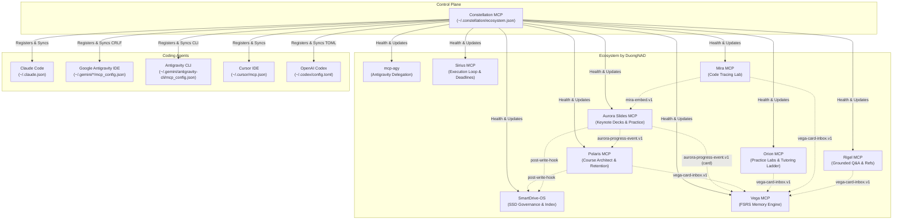
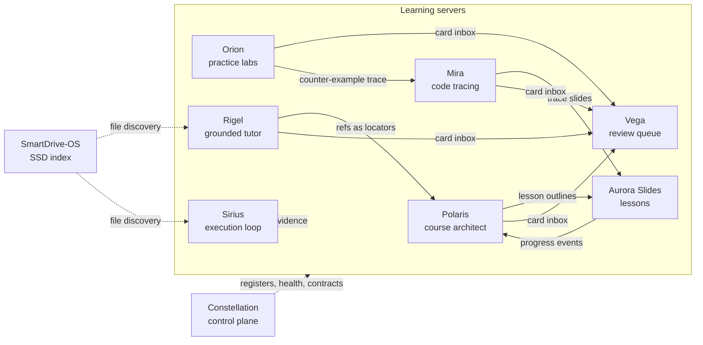

[Tiếng Việt](README.vi.md) | **English**

<p align="center"></p>

# Constellation MCP

*Stars joined into one figure, like servers joined into one ecosystem.*

Control plane of the learner's MCP ecosystem: one manifest of servers, one command to register them across coding agents (Claude Code, Google Antigravity, Antigravity CLI, Cursor, Codex), automated health checks, drift doctor, safe updates, and shared contracts.



---

## Ecosystem Overview

All projects by DuongNAD:

| Project | Role | Repository |
| :--- | :--- | :--- |
| **Polaris** | Course architect: sources, facts with locators, roadmap, schedule, error log | [polaris-mcp](https://github.com/DuongNAD/polaris-mcp) |
| **Aurora Slides** | Keynote-style lessons: quizzes, predict and trace slides, progress events | [aurora-slides-mcp](https://github.com/DuongNAD/aurora-slides-mcp) |
| **Vega** | FSRS memory engine and the single review queue (card inbox) | [vega-mcp](https://github.com/DuongNAD/vega-mcp) |
| **Orion** | Practice labs with real tests, tutoring ladder and PRIMM warm-up | [orion-mcp](https://github.com/DuongNAD/orion-mcp) |
| **Mira** | Code-tracing lab: real Python traces, line-by-line players with prediction gates | [mira-mcp](https://github.com/DuongNAD/mira-mcp) |
| **Rigel** | Grounded tutor: answers from the learner's lesson materials with [ref] citations | [rigel-mcp](https://github.com/DuongNAD/rigel-mcp) |
| **Sirius** | Execution loop: deadlines, triage, today router, session timer, weekly review | [sirius-mcp](https://github.com/DuongNAD/sirius-mcp) |
| **Constellation** | MCP registration, health checks and shared contracts | [constellation-mcp](https://github.com/DuongNAD/constellation-mcp) |
| **SmartDrive-OS** | SSD governance, index and learning search | [smart-drive-os](https://github.com/DuongNAD/smart-drive-os) |

### Connections

- Registers every server in Claude Code, Antigravity, Cursor and Codex, checks health and drift, and owns the shared contracts: `aurora-progress-event.v1`, `vega-card-inbox.v1`, `mira-embed.v1`, `personal-data`, `learning-units`, `post-write-hook`, `source-labels`.

---

## Ecosystem data flows

Solid arrows are data one server hands to another; dashed arrows are read-only access (evidence, file discovery) or control-plane registration.



---

## Why Constellation

When orchestrating multiple MCP servers across different coding assistants, several points of friction arise:
1. Each server must be manually added to Claude Code and multiple Antigravity configuration files (`~/.gemini/antigravity`, `~/.gemini/config`, and `~/.gemini/antigravity-ide` `mcp_config.json` with CRLF line endings) as well as `~/.gemini/antigravity-cli/mcp_config.json`.
2. Different IDE agents overwrite or desynchronize config files.
3. Starting conversations before a server finishes initialization leads to missing tool binding.
4. Headless subagents (like `mcp-agy`) need lightweight configurations without every heavy GUI tool loaded.
5. Shared contracts between tools (e.g. progress event v1, the Vega card inbox, the Mira embed protocol, learning-unit markers, post-write hooks, source labels, and personal-data ignore patterns) drift if not anchored in a single source of truth.

Constellation unifies all configuration and verification into a single, automated control plane.

---

## Principles

1. **Never Lose a Config**: Rolling backups (`<file>.bak.constellation`) are created before the run's first change, ensuring a run is fully reversible. Each config file is written at most once per run. Writes are atomic and preserve original line endings (`CRLF`/`LF`) and 2-space indentation. Unmanaged entries are left untouched.
2. **Never Leak Secrets**: Environment variables matching `/KEY|TOKEN|SECRET|PASSWORD|AUTH/i` are masked as `"***"` across all outputs and diffs. The manifest stores references (`${secret:NAME}`) rather than plaintext secrets.
3. **BOM-Tolerant & Credential-Safe**: Strips leading UTF-8 BOM (`\uFEFF`) on reads, warns in `doctor`, and rewrites files cleanly without a BOM on `register`. Server environment variables existing in agent configs but not in the manifest are preserved (merged) rather than silently dropped, and reported in diffs (masked).
4. **Idempotent and Explainable**: Every command supports a dry run that produces exact diffs before touching disk.
5. **Toolchain Discipline**: Built with TypeScript into a single standalone bundle (`dist/constellation.mjs`) using an external toolchain (`CONSTELLATION_TOOLCHAIN`), keeping exFAT workspaces free of `node_modules`.

---

## Supported Agents

- **Claude Code** (`claude`): Invokes `claude mcp add` / `claude mcp remove` CLI commands; inspects and updates `~/.claude.json`.
- **Google Antigravity** (`antigravity`): Keeps the 3 IDE/GUI copies in sync (`~/.gemini/antigravity`, `~/.gemini/config`, `~/.gemini/antigravity-ide`).
- **Antigravity CLI** (`antigravity-cli`): Manages `~/.gemini/antigravity-cli/mcp_config.json` for headless subagents (used by `mcp-agy`). Existing manifests listing only `"antigravity"` target the IDE files; run `import` to update.
- **Cursor IDE** (`cursor`): Manages `~/.cursor/mcp.json`.
- **OpenAI Codex** (`codex`): Manages `~/.codex/config.toml` tables.

---

## Installation & Connection

### 1. Build the Binary
```bash
# Set external toolchain path
$env:CONSTELLATION_TOOLCHAIN = "C:\Users\Admin\AppData\Local\Packages\Claude_pzs8sxrjxfjjc\LocalCache\Local\aurora-slides\toolchain"

# Typecheck and bundle
node scripts/build.mjs --check
```

### 2. Connect as an MCP Server
Add Constellation to your agent configuration:

```json
{
  "mcpServers": {
    "constellation": {
      "command": "node",
      "args": ["D:/03_Development_Projects/ai_agents/constellation_mcp/dist/constellation.mjs"]
    }
  }
}
```

---

## Tools Reference

| Tool Name | Purpose |
|---|---|
| `eco_status` | Status matrix showing server registration across all agents, sync state, and Git status. |
| `eco_import` | Scans existing agent configs and bootstraps `~/.constellation/ecosystem.json` with secret references. |
| `eco_register` | Synchronizes servers from manifest into Claude Code, Antigravity, Antigravity CLI, Cursor, and Codex. |
| `eco_unregister` | Safely removes one or more servers from targeted agent configurations (and optionally forgets from manifest). |
| `eco_health` | Starts child servers over stdio, performs client handshakes, lists tools, and records latencies. |
| `eco_doctor` | Detects config drift, missing file paths, Antigravity copy mismatches, and groups unmanaged servers. |
| `eco_update` | Pulls (`git pull --ff-only` on clean trees) and runs configured `build` and `test` scripts. |
| `eco_contracts` | Lists shared contracts, displays specifications, and validates JSONL files (progress events, Vega card inbox lines, Mira embed messages) and `.gitignore` coverage. |

---

## CLI Reference

The CLI mirrors all MCP tools:

```bash
# View status
node dist/constellation.mjs status
 
# Import from existing agent configs
node dist/constellation.mjs import --dry-run
node dist/constellation.mjs import

# Register servers
node dist/constellation.mjs register --dry-run
node dist/constellation.mjs register polaris aurora-slides

# Unregister servers (batch and forget options)
node dist/constellation.mjs unregister broken-server fake-server --forget

# Health check
node dist/constellation.mjs health

# Doctor diagnostic
node dist/constellation.mjs doctor

# Validate contract fixtures
node dist/constellation.mjs contracts validate aurora-progress-event.v1 contracts/fixtures/valid-progress.jsonl

# Validate Vega card inbox lines (per-line errors, OK summary)
node dist/constellation.mjs contracts validate vega-card-inbox.v1 contracts/vega-card-inbox.v1/fixtures/valid.jsonl

# Validate Mira embed messages (player <-> Aurora deck)
node dist/constellation.mjs contracts validate mira-embed.v1 contracts/mira-embed.v1/fixtures/valid.jsonl

# Validate .gitignore against personal data contract
node dist/constellation.mjs contracts validate personal-data .gitignore
```

---

## Shared Contracts

1. [`aurora-progress-event.v1`](contracts/aurora-progress-event.v1/README.md): Interactive learning event specification emitted by Aurora (quiz, predict, recall, complete, card) and consumed by Polaris and Vega.
2. [`learning-units`](contracts/learning-units/README.md): Protected folder markers (`course.json`, `deck.json`, `polaris/brief.json`) and SmartDrive SSD rules.
3. [`post-write-hook`](contracts/post-write-hook/README.md): Debounced `smart-drive update <dir> --quiet` notification standard.
4. [`source-labels`](contracts/source-labels/README.md): "Khóa học" / "Mở rộng" / "chưa xác minh" label mappings.
5. [`personal-data`](contracts/personal-data/README.md): Canonical ignore patterns for sensitive personal learning data (`.vega/`, `**/progress.jsonl`, `aurora-progress-*.jsonl`, `orion-attempts.jsonl`, `.polaris/`, `.sirius/`) and third-party/regenerable files (`**/polaris/captures/`, `**/polaris/.cache/`). Includes automated `.gitignore` validator.
6. [`vega-card-inbox.v1`](contracts/vega-card-inbox.v1/README.md): One adaptive review queue. Polaris, Orion, Mira and Rigel (and Aurora, Sirius, manual) drop card candidates as JSON Lines files in `<hub>/.vega/inbox/`; Vega alone validates, deduplicates by key and schedules them with FSRS. Amended on 2026-10-13 (backward compatible, still v1) with the producer `rigel` and the origin kind `rigel-ref`. Includes JSON Schema, fixtures and a line validator.
7. [`mira-embed.v1`](contracts/mira-embed.v1/README.md): `postMessage` protocol between a Mira player (iframe) and the Aurora deck that embeds it in a `trace` slide: `ready`, `event` and `blur` from the player, `hello` from the deck. Includes JSON Schema, fixtures and a message validator.

Which server uses which contract:

| Server | Contracts |
|---|---|
| **Polaris** | `aurora-progress-event.v1`, `learning-units`, `post-write-hook`, `source-labels`, `personal-data`, `vega-card-inbox.v1` |
| **Aurora Slides** | `aurora-progress-event.v1`, `learning-units`, `post-write-hook`, `source-labels`, `personal-data`, `mira-embed.v1` |
| **Vega** | `aurora-progress-event.v1` (`card` event), `vega-card-inbox.v1`, `personal-data` |
| **Orion** | `personal-data`, `vega-card-inbox.v1` |
| **Mira** | `mira-embed.v1`, `aurora-progress-event.v1` (`predict`, `complete` events), `vega-card-inbox.v1`, `personal-data` |
| **Rigel** | `vega-card-inbox.v1` |
| **Sirius** | `personal-data` |
| **SmartDrive-OS** | `learning-units`, `post-write-hook`, `personal-data` |

---

## Version History

- **0.1.8** (2026-10-13):
  - **`vega-card-inbox.v1` amended (backward compatible, still v1)**: new producer `rigel` (Rigel, grounded Q&A over the learner's lesson materials) and new origin kind `rigel-ref` (a citable chunk of a lesson file: `path` = absolute path of the source file, `locator` = `<ref> · <slide/page/section>` such as `D3#12 · slide 7`, `href` optional). Key convention `rigel:<subject or course>:<ref>:<first 8 hex of sha1(front)>`. The validator, `schema.json` (both enums and the `rigel:` key prefix rule), the contract README (amendment section, key table) and the fixtures (one valid and one invalid `rigel` line) know both values; every line that was valid before is still valid.
  - **Ecosystem lists**: Rigel (rigel-mcp) added to the guide overview, the server instructions, the README tables and diagram (no repository link).
- **0.1.7** (2026-10-12):
  - **Vega card inbox contract (`vega-card-inbox.v1`)**: one adaptive review queue. Polaris, Orion and Mira drop card candidates as JSON Lines files in `<hub>/.vega/inbox/` and Vega alone validates, deduplicates by key and schedules them with FSRS. Includes README, JSON Schema, fixtures and a validator (`constellation contracts validate vega-card-inbox.v1 <file>`) with per-line errors.
  - **Mira embed contract (`mira-embed.v1`)**: the `postMessage` protocol between Mira players and Aurora `trace` slides (`ready`, `event`, `blur` from the player, `hello` from the deck), with field rules, relayed events, security notes, JSON Schema, fixtures and a message validator.
  - **`personal-data` now has 8 canonical patterns**: `.sirius/` protects the Sirius execution journal (sessions, implementation intentions, triage decisions, derived `triage.json`). Valid `.gitignore` fixtures cover 8/8 patterns; a `.gitignore` written for 0.1.6 now reports `.sirius/` as missing.
  - **Ecosystem lists**: Orion, Sirius and Mira added to the guide overview, the server instructions and the README tables and diagram; `contracts list`/`show`/`validate` know the two new contracts and accept the short names `vega-card-inbox`, `card-inbox` and `mira-embed`.
- **0.1.6** (2026-10-11):
  - Register resolves `${secret:NAME}` from the process environment or `~/.constellation/secrets.json` and writes the real value; an agent that already has the server keeps its value only when the store has none; a secret that cannot be resolved is refused (the placeholder is never written).
  - Register compares real values (shown masked), so a rotated key or a leftover placeholder is updated ("updated secret value ... (values hidden)").
  - Doctor flags agent configs that hold the unresolved placeholder or a secret that differs from the store.
- **0.1.5** (2026-10-11):
  - **UTF-8 BOM Tolerance**: Tolerates leading UTF-8 BOM (`\uFEFF`) across all agent configurations and manifest files; `doctor` notices any BOM file ("starts with a UTF-8 BOM; some JSON parsers reject it; the next register rewrites it without one"); `register` rewrites files cleanly without a BOM.
  - **Resilient Config Diagnostics**: Unparseable JSON configs report a single file-level parse error instead of cascading false "missing server" warnings.
  - **Env Drift Detection & Safe Retention**: `doctor` flags unmanaged environment variables in agent configs by name only (values masked) with instructions to add them to `ecosystem.json` and secrets storage. `register` merges and retains unmanaged env keys instead of erasing them, displaying them masked in dry-run diffs.
- **0.1.4** (2026-10-11):
  - **Polaris Learner Profile Contract**: Added `.polaris/` as the 7th canonical ignore pattern to `personal-data` contract (`contracts/personal-data/patterns.json`) covering `<hub>/.polaris/learner.json` (study slots, blackout dates, commitments, study-method preferences).
  - **Updated Test Fixtures & Validator**: Updated valid `.gitignore` fixtures to cover all 7 patterns and adjusted validation expectations to 7/7 patterns.
- **0.1.3** (2026-10-11):
  - **Personal Data & Sensitive Files Contract (`personal-data`)**: Added shared contract and automated `.gitignore` validator covering personal learning data (`.vega/`, `**/progress.jsonl`, `aurora-progress-*.jsonl`, `orion-attempts.jsonl`) and third-party/regenerable assets (`**/polaris/captures/`, `**/polaris/.cache/`).
  - **Canonical Machine-Readable Patterns**: Added `contracts/personal-data/patterns.json` with project ownership, sensitivity rationale, and git untracking remediation (`git rm --cached`).
  - **Tooling Alignment**: Standardized managed block integration for SmartDrive-OS (`smart-drive gitignore apply`) and documented Polaris automatic `polaris/.gitignore` creation.
  - **CLI & MCP Gitignore Validation**: Added `constellation contracts validate personal-data <path-to-.gitignore>` with parent directory and wildcard pattern coverage checks.
- **0.1.2** (2026-10-11):
  - **Active Recall SRS Card Contract**: Added `card` event type to `aurora-progress-event.v1` (`card`, `rating`: again/hard/good/easy, optional `ms`) emitted by Aurora Slides `srs` slide for Vega FSRS memory engine ingestion.
  - **Multi-Server Unregister & Manifest Forget**: `constellation unregister a b c` / `eco_unregister {servers}` batches unregistration across all target agents in a single write with pre-run backup; `--forget` / `{forget: true}` removes entries from `ecosystem.json`.
- **0.1.1** (2026-10-11):
  - **Reversible Backups**: Batch changes per config file; each file is written at most once per run, and rolling backups (`*.bak.constellation`) capture the exact state before the run.
  - **Antigravity CLI Agent Target**: Split `antigravity-cli` (`~/.gemini/antigravity-cli/mcp_config.json`) from `antigravity` (3 IDE copies) to support minimal subagent setups without spurious drift warnings.
  - **Compact Doctor Report**: Group unmanaged servers into a single line per agent; cleanly report empty manifests with import guidance; maintain one-line drift reporting with exact fixes.
- **0.1.0** (2026-10-11): Initial release with 9 MCP tools, CLI, multi-agent registration, stdio health checks, drift diagnostics, safe update engine, and shared contracts validation.

---

## License

MIT (c) 2026 DuongNAD
