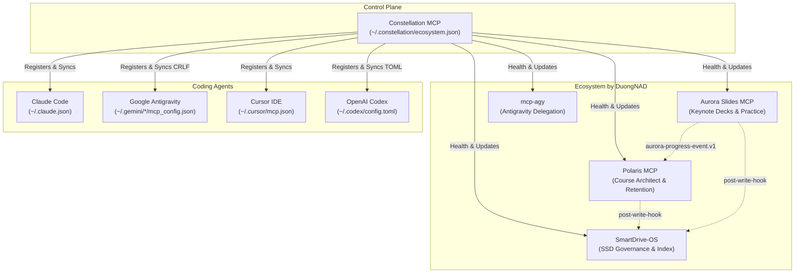

[Tiếng Việt](README.vi.md) | **English**

# Constellation MCP

Control plane of the learner's MCP ecosystem: one manifest of servers, one command to register them across coding agents (Claude Code, Google Antigravity, Cursor, Codex), automated health checks, drift doctor, safe updates, and shared contracts.



---

## Why Constellation

When orchestrating multiple MCP servers across different coding assistants, several points of friction arise:
1. Each server must be manually added to Claude Code and multiple Antigravity configuration files (`~/.gemini/antigravity`, `~/.gemini/config`, and `~/.gemini/antigravity-ide` `mcp_config.json` with CRLF line endings).
2. Different IDE agents overwrite or desynchronize config files.
3. Starting conversations before a server finishes initialization leads to missing tool binding.
4. Shared contracts between tools (e.g. progress event v1, learning-unit markers, post-write hooks, and source labels) drift if not anchored in a single source of truth.

Constellation unifies all configuration and verification into a single, automated control plane.

---

## Principles

1. **Never Lose a Config**: Rolling backups (`<file>.bak.constellation`) are created before every write. Writes are atomic and preserve original line endings (`CRLF`/`LF`) and 2-space indentation. Unmanaged entries are left untouched.
2. **Never Leak Secrets**: Environment variables matching `/KEY|TOKEN|SECRET|PASSWORD|AUTH/i` are masked as `"***"` across all outputs and diffs. The manifest stores references (`${secret:NAME}`) rather than plaintext secrets.
3. **Idempotent and Explainable**: Every command supports a dry run that produces exact diffs before touching disk.
4. **Toolchain Discipline**: Built with TypeScript into a single standalone bundle (`dist/constellation.mjs`) using an external toolchain (`CONSTELLATION_TOOLCHAIN`), keeping exFAT workspaces free of `node_modules`.

---

## Installation & Connection

### 1. Build the Binary
```bash
# Set external toolchain path
$env:CONSTELLATION_TOOLCHAIN = "C:\Users\Admin\AppData\Local\Packages\Claude_pzs8sxrjxfjjc\LocalCache\Local\aurora-slides\toolchain"

# Typecheck and bundle
node scripts/build.mjs --check
```

### 2. Connect as an MCP Server
Add Constellation to your agent configuration:

```json
{
  "mcpServers": {
    "constellation": {
      "command": "node",
      "args": ["D:/03_Development_Projects/ai_agents/constellation_mcp/dist/constellation.mjs"]
    }
  }
}
```

---

## Tools Reference

| Tool Name | Purpose |
|---|---|
| `eco_status` | Status matrix showing server registration across all agents, sync state, and Git status. |
| `eco_import` | Scans existing agent configs and bootstraps `~/.constellation/ecosystem.json` with secret references. |
| `eco_register` | Synchronizes servers from manifest into Claude Code, Antigravity, Cursor, and Codex. |
| `eco_unregister` | Safely removes a server from targeted agent configurations. |
| `eco_health` | Starts child servers over stdio, performs client handshakes, lists tools, and records latencies. |
| `eco_doctor` | Detects config drift, missing file paths, Antigravity copy mismatches, and unmanaged servers. |
| `eco_update` | Pulls (`git pull --ff-only` on clean trees) and runs configured `build` and `test` scripts. |
| `eco_contracts` | Lists shared contracts, displays specifications, and validates JSON/JSONL progress event files. |

---

## CLI Reference

The CLI mirrors all MCP tools:

```bash
# View status
node dist/constellation.mjs status

# Import from existing agent configs
node dist/constellation.mjs import --dry-run
node dist/constellation.mjs import

# Register servers
node dist/constellation.mjs register --dry-run
node dist/constellation.mjs register polaris aurora-slides

# Health check
node dist/constellation.mjs health

# Doctor diagnostic
node dist/constellation.mjs doctor

# Validate contract fixtures
node dist/constellation.mjs contracts validate aurora-progress-event.v1 contracts/fixtures/valid-progress.jsonl
```

---

## Shared Contracts

1. [`aurora-progress-event.v1`](contracts/aurora-progress-event.v1/README.md): Interactive learning event specification emitted by Aurora and consumed by Polaris.
2. [`learning-units`](contracts/learning-units/README.md): Protected folder markers (`course.json`, `deck.json`, `polaris/brief.json`) and SmartDrive SSD rules.
3. [`post-write-hook`](contracts/post-write-hook/README.md): Debounced `smart-drive update <dir> --quiet` notification standard.
4. [`source-labels`](contracts/source-labels/README.md): "Khóa học" / "Mở rộng" / "chưa xác minh" label mappings.

---

## License

MIT (c) 2026 DuongNAD
