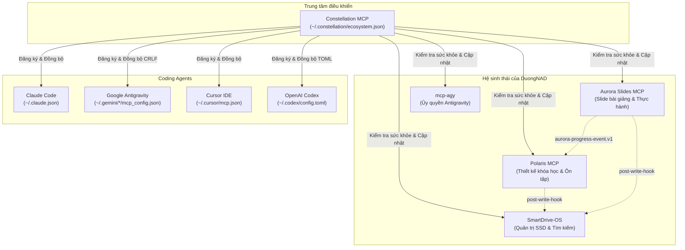

[English](README.md) | **Tiếng Việt**

# Constellation MCP

Trung tâm điều khiển hệ sinh thái MCP cho người học: một tệp cấu hình máy chủ tập trung (manifest), một lệnh đăng ký vào tất cả các coding agent (Claude Code, Google Antigravity, Cursor, Codex), kiểm tra sức khỏe tự động, phát hiện lệch cấu hình (drift doctor), cập nhật an toàn và quản lý các hợp đồng giao tiếp chung.



---

## Vì sao cần Constellation

Khi vận hành nhiều MCP server trên các công cụ lập trình khác nhau, một số vấn đề thường xuyên phát sinh:
1. Mỗi máy chủ phải thêm thủ công vào Claude Code và 3 tệp cấu hình Antigravity (`~/.gemini/antigravity`, `~/.gemini/config`, `~/.gemini/antigravity-ide` `mcp_config.json` với định dạng xuống dòng CRLF).
2. Các agent khác nhau có thể ghi đè làm lệch hoặc mất cấu hình của nhau.
3. Khi mở hội thoại trước khi server khởi động xong, agent báo lỗi không liên kết được công cụ.
4. Các hợp đồng chung giữa các dự án (như sự kiện tiến độ v1, đánh dấu bài học, hook sau khi ghi, nhãn nguồn tài liệu) nằm rải rác.

Constellation hợp nhất toàn bộ cấu hình, kiểm tra và bảo trì vào một nguồn chân lý duy nhất.

---

## Nguyên tắc hoạt động

1. **Không bao giờ làm mất cấu hình**: Tạo bản sao lưu xoay vòng (`<file>.bak.constellation`) trước mỗi lần ghi. Ghi tệp nguyên tử (atomic write), giữ nguyên định dạng xuống dòng (`CRLF`/`LF`) và thụt lề 2 khoảng trắng. Chỉ chỉnh sửa các mục do Constellation quản lý.
2. **Không làm rò rỉ khóa bảo mật**: Các biến môi trường chứa từ khóa `/KEY|TOKEN|SECRET|PASSWORD|AUTH/i` luôn được ẩn thành `"***"` trong mọi đầu ra và bản so sánh diff. Manifest chỉ lưu tham chiếu (`${secret:NAME}`).
3. **Bất biến và minh bạch (Idempotent)**: Mọi lệnh ghi đều hỗ trợ chế độ chạy thử (`--dry-run`) hiển thị chính xác nội dung thay đổi trước khi áp dụng.
4. **Kỷ luật Toolchain**: Viết bằng TypeScript, đóng gói thành một tệp duy nhất (`dist/constellation.mjs`) sử dụng toolchain bên ngoài (`CONSTELLATION_TOOLCHAIN`), không tạo thư mục `node_modules` trên ổ đĩa exFAT.

---

## Cài đặt & Kết nối

### 1. Đóng gói dự án
```bash
# Thiết lập đường dẫn toolchain
$env:CONSTELLATION_TOOLCHAIN = "C:\Users\Admin\AppData\Local\Packages\Claude_pzs8sxrjxfjjc\LocalCache\Local\aurora-slides\toolchain"

# Kiểm tra kiểu và đóng gói
node scripts/build.mjs --check
```

### 2. Kết nối vào cấu hình MCP
Thêm Constellation vào tệp cấu hình agent của bạn:

```json
{
  "mcpServers": {
    "constellation": {
      "command": "node",
      "args": ["D:/03_Development_Projects/ai_agents/constellation_mcp/dist/constellation.mjs"]
    }
  }
}
```

---

## Danh mục công cụ (Tools)

| Tên công cụ | Mục đích |
|---|---|
| `eco_status` | Bảng ma trận trạng thái đăng ký, độ đồng bộ và trạng thái Git của các máy chủ. |
| `eco_import` | Quét cấu hình các agent hiện có và nạp vào `~/.constellation/ecosystem.json` với tham chiếu bảo mật. |
| `eco_register` | Đăng ký các máy chủ từ manifest vào Claude Code, Antigravity, Cursor, Codex. |
| `eco_unregister` | Hủy đăng ký an toàn máy chủ khỏi các agent được chỉ định. |
| `eco_health` | Khởi động máy chủ qua stdio, bắt tay client, kiểm tra danh sách công cụ và đo độ trễ. |
| `eco_doctor` | Phát hiện lệch cấu hình, đường dẫn tệp không tồn tại, lệch giữa các bản sao Antigravity. |
| `eco_update` | Cập nhật an toàn với `git pull --ff-only` trên cây mã nguồn sạch, chạy lệnh `build` và `test`. |
| `eco_contracts` | Xem danh sách hợp đồng chung, xem tài liệu đặc tả và kiểm định tệp sự kiện tiến độ JSON/JSONL. |

---

## Dòng lệnh CLI

CLI cung cấp đầy đủ các tính năng tương đương MCP tools:

```bash
# Xem trạng thái
node dist/constellation.mjs status

# Nạp cấu hình hiện có vào manifest
node dist/constellation.mjs import --dry-run
node dist/constellation.mjs import

# Đăng ký máy chủ vào các agent
node dist/constellation.mjs register --dry-run
node dist/constellation.mjs register polaris aurora-slides

# Kiểm tra sức khỏe kết nối
node dist/constellation.mjs health

# Chạy chẩn đoán lỗi hệ sinh thái
node dist/constellation.mjs doctor

# Kiểm định hợp đồng sự kiện
node dist/constellation.mjs contracts validate aurora-progress-event.v1 contracts/fixtures/valid-progress.jsonl
```

---

## Hợp đồng dùng chung (Contracts)

1. [`aurora-progress-event.v1`](contracts/aurora-progress-event.v1/README.md): Đặc tả sự kiện học tập tương tác phát ra từ Aurora và nạp vào Polaris.
2. [`learning-units`](contracts/learning-units/README.md): Quy chuẩn đánh dấu thư mục học tập (`course.json`, `deck.json`, `polaris/brief.json`) và quy tắc bảo vệ của SmartDrive.
3. [`post-write-hook`](contracts/post-write-hook/README.md): Cơ chế thông báo cập nhật ngầm `smart-drive update <dir> --quiet`.
4. [`source-labels`](contracts/source-labels/README.md): Quy ước nhãn tài liệu "Khóa học" / "Mở rộng" / "chưa xác minh".

---

## Bản quyền

MIT (c) 2026 DuongNAD
