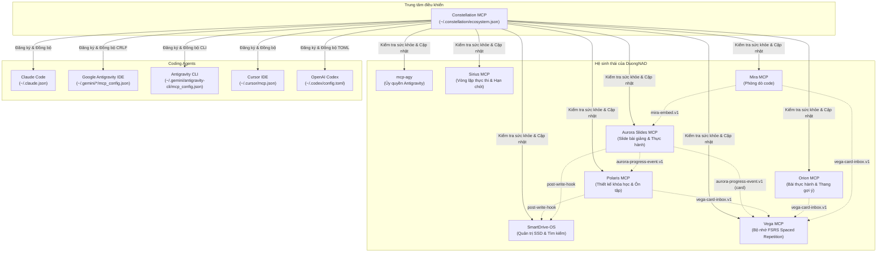

[English](README.md) | **Tiếng Việt**

<p align="center"></p>

# Constellation MCP

*Các vì sao liên kết thành một chòm sao, tựa như các máy chủ kết nối thành một hệ sinh thái duy nhất.*

Trung tâm điều khiển hệ sinh thái MCP cho người học: một tệp cấu hình máy chủ tập trung (manifest), một lệnh đăng ký vào tất cả các coding agent (Claude Code, Google Antigravity, Antigravity CLI, Cursor, Codex), kiểm tra sức khỏe tự động, phát hiện lệch cấu hình (drift doctor), cập nhật an toàn và quản lý các hợp đồng giao tiếp chung.



---

## Tổng quan hệ sinh thái

| Máy chủ / Công cụ | Mã nguồn (Repo) | Mục đích | Hợp đồng dùng chung |
|---|---|---|---|
| **Polaris** | [polaris-mcp](https://github.com/DuongNAD/polaris-mcp) | Thiết kế lộ trình học, tra cứu dữ liệu, lịch ôn tập ngắt quãng | `aurora-progress-event.v1`, `learning-units`, `post-write-hook`, `source-labels`, `personal-data`, `vega-card-inbox.v1` |
| **Aurora Slides** | [aurora-slides-mcp](https://github.com/DuongNAD/aurora-slides-mcp) | Slide thuyết trình, bài tập tương tác, slide thẻ SRS, slide `trace` của Mira | `aurora-progress-event.v1`, `learning-units`, `post-write-hook`, `source-labels`, `personal-data`, `mira-embed.v1` |
| **Vega** | [vega-mcp](https://github.com/DuongNAD/vega-mcp) | Bộ nhớ thuật toán FSRS (`vega_sync`, hộp thư thẻ) | `aurora-progress-event.v1` (sự kiện `card`), `vega-card-inbox.v1`, `personal-data` |
| **SmartDrive-OS** | [smart-drive-os](https://github.com/DuongNAD/smart-drive-os) | Quản trị SSD, tìm kiếm ngữ nghĩa BM25/vector | `learning-units`, `post-write-hook`, `personal-data` |
| **Orion** | [orion-mcp](https://github.com/DuongNAD/orion-mcp) | Bài thực hành có test thật và thang gợi ý từng bậc | `personal-data`, `vega-card-inbox.v1` |
| **Sirius** | [sirius-mcp](https://github.com/DuongNAD/sirius-mcp) | Vòng lặp thực thi: canh hạn chót, phân loại việc, định tuyến hôm nay, bấm giờ phiên học, đối chiếu kế hoạch và thực tế hằng tuần | `personal-data` |
| **Mira** | [mira-mcp](https://github.com/DuongNAD/mira-mcp) | Phòng dò code: vết chạy Python thật, trình phát từng dòng với điểm dừng dự đoán, nhúng được vào slide `trace` của Aurora | `mira-embed.v1`, `aurora-progress-event.v1` (sự kiện `predict`, `complete`), `vega-card-inbox.v1`, `personal-data` |
| **mcp-agy** | [mcp-agy](https://github.com/DuongNAD/mcp-agy) | Cổng ủy quyền Google Antigravity cho subagent | — |

---

## Vì sao cần Constellation

Khi vận hành nhiều MCP server trên các công cụ lập trình khác nhau, một số vấn đề thường xuyên phát sinh:
1. Mỗi máy chủ phải thêm thủ công vào Claude Code và 3 tệp cấu hình Antigravity (`~/.gemini/antigravity`, `~/.gemini/config`, `~/.gemini/antigravity-ide` `mcp_config.json` với định dạng xuống dòng CRLF) cũng như `~/.gemini/antigravity-cli/mcp_config.json`.
2. Các agent khác nhau có thể ghi đè làm lệch hoặc mất cấu hình của nhau.
3. Khi mở hội thoại trước khi server khởi động xong, agent báo lỗi không liên kết được công cụ.
4. Các subagent không giao diện (headless như `mcp-agy`) cần cấu hình gọn nhẹ, không muốn nạp toàn bộ công cụ IDE.
5. Các hợp đồng chung giữa các dự án (như sự kiện tiến độ v1, hộp thư thẻ của Vega, giao thức nhúng của Mira, đánh dấu bài học, hook sau khi ghi, nhãn nguồn tài liệu, mẫu loại trừ dữ liệu cá nhân) nằm rải rác.

Constellation hợp nhất toàn bộ cấu hình, kiểm tra và bảo trì vào một nguồn chân lý duy nhất.

---

## Nguyên tắc hoạt động

1. **Không bao giờ làm mất cấu hình**: Tạo bản sao lưu xoay vòng (`<file>.bak.constellation`) trước thay đổi đầu tiên của phiên chạy, giúp toàn bộ thao tác có thể khôi phục hoàn toàn. Mỗi tệp cấu hình được ghi tối đa 1 lần mỗi lần chạy. Ghi tệp nguyên tử (atomic write), giữ nguyên định dạng xuống dòng (`CRLF`/`LF`) và thụt lề 2 khoảng trắng.
2. **Không làm rò rỉ khóa bảo mật**: Các biến môi trường chứa từ khóa `/KEY|TOKEN|SECRET|PASSWORD|AUTH/i` luôn được ẩn thành `"***"` trong mọi đầu ra và bản so sánh diff. Manifest chỉ lưu tham chiếu (`${secret:NAME}`).
3. **Chống lỗi UTF-8 BOM & Bảo toàn biến môi trường**: Tự động loại bỏ ký tự BOM (`\uFEFF`) khi đọc cấu hình JSON, cảnh báo trong `doctor`, và ghi lại tệp sạch không BOM khi chạy `register`. Các biến môi trường riêng có sẵn trong agent config mà chưa khai báo trong manifest sẽ được giữ lại (merge) thay vì bị xóa mất, đồng thời hiển thị che mờ (`***`) trong bản so sánh diff.
4. **Bất biến và minh bạch (Idempotent)**: Mọi lệnh ghi đều hỗ trợ chế độ chạy thử (`--dry-run`) hiển thị chính xác nội dung thay đổi trước khi áp dụng.
5. **Kỷ luật Toolchain**: Viết bằng TypeScript, đóng gói thành một tệp duy nhất (`dist/constellation.mjs`) sử dụng toolchain bên ngoài (`CONSTELLATION_TOOLCHAIN`), không tạo thư mục `node_modules` trên ổ đĩa exFAT.

---

## Các Agent được hỗ trợ

- **Claude Code** (`claude`): Gọi CLI `claude mcp add` / `claude mcp remove`; kiểm tra và đồng bộ `~/.claude.json`.
- **Google Antigravity** (`antigravity`): Đồng bộ 3 bản sao IDE/GUI (`~/.gemini/antigravity`, `~/.gemini/config`, `~/.gemini/antigravity-ide`).
- **Antigravity CLI** (`antigravity-cli`): Quản lý tệp `~/.gemini/antigravity-cli/mcp_config.json` cho subagent chạy nền (`mcp-agy`). Các manifest cũ chỉ ghi `"antigravity"` sẽ tự động trỏ đến các bản sao IDE; chạy `import` để cập nhật.
- **Cursor IDE** (`cursor`): Quản lý `~/.cursor/mcp.json`.
- **OpenAI Codex** (`codex`): Quản lý các bảng `[mcp_servers.<name>]` trong `~/.codex/config.toml`.

---

## Cài đặt & Kết nối

### 1. Đóng gói dự án
```bash
# Thiết lập đường dẫn toolchain
$env:CONSTELLATION_TOOLCHAIN = "C:\Users\Admin\AppData\Local\Packages\Claude_pzs8sxrjxfjjc\LocalCache\Local\aurora-slides\toolchain"

# Kiểm tra kiểu và đóng gói
node scripts/build.mjs --check
```

### 2. Kết nối vào cấu hình MCP
Thêm Constellation vào tệp cấu hình agent của bạn:

```json
{
  "mcpServers": {
    "constellation": {
      "command": "node",
      "args": ["D:/03_Development_Projects/ai_agents/constellation_mcp/dist/constellation.mjs"]
    }
  }
}
```

---

## Danh mục công cụ (Tools)

| Tên công cụ | Mục đích |
|---|---|
| `eco_status` | Bảng ma trận trạng thái đăng ký, độ đồng bộ và trạng thái Git của các máy chủ. |
| `eco_import` | Quét cấu hình các agent hiện có và nạp vào `~/.constellation/ecosystem.json` với tham chiếu bảo mật. |
| `eco_register` | Đăng ký các máy chủ từ manifest vào Claude Code, Antigravity, Antigravity CLI, Cursor, Codex. |
| `eco_unregister` | Hủy đăng ký an toàn một hoặc nhiều máy chủ khỏi các agent (và tùy chọn quên khỏi manifest). |
| `eco_health` | Khởi động máy chủ qua stdio, bắt tay client, kiểm tra danh sách công cụ và đo độ trễ. |
| `eco_doctor` | Phát hiện lệch cấu hình, đường dẫn tệp không tồn tại, gom nhóm danh sách server chưa quản lý. |
| `eco_update` | Cập nhật an toàn với `git pull --ff-only` trên cây mã nguồn sạch, chạy lệnh `build` và `test`. |
| `eco_contracts` | Xem danh sách hợp đồng chung, xem tài liệu đặc tả và kiểm định tệp JSONL (sự kiện tiến độ, dòng thẻ trong hộp thư Vega, thông điệp nhúng của Mira) cùng độ phủ của `.gitignore`. |

---

## Dòng lệnh CLI

CLI cung cấp đầy đủ các tính năng tương đương MCP tools:

```bash
# Xem trạng thái
node dist/constellation.mjs status

# Nạp cấu hình hiện có vào manifest
node dist/constellation.mjs import --dry-run
node dist/constellation.mjs import

# Đăng ký máy chủ vào các agent
node dist/constellation.mjs register --dry-run
node dist/constellation.mjs register polaris aurora-slides

# Hủy đăng ký nhiều máy chủ (kèm tùy chọn quên khỏi manifest)
node dist/constellation.mjs unregister broken-server fake-server --forget

# Kiểm tra sức khỏe kết nối
node dist/constellation.mjs health

# Chạy chẩn đoán lỗi hệ sinh thái
node dist/constellation.mjs doctor

# Kiểm định hợp đồng sự kiện
node dist/constellation.mjs contracts validate aurora-progress-event.v1 contracts/fixtures/valid-progress.jsonl

# Kiểm định các dòng thẻ trong hộp thư Vega (báo lỗi theo từng dòng, tóm tắt OK)
node dist/constellation.mjs contracts validate vega-card-inbox.v1 contracts/vega-card-inbox.v1/fixtures/valid.jsonl

# Kiểm định thông điệp nhúng của Mira (trình phát <-> deck Aurora)
node dist/constellation.mjs contracts validate mira-embed.v1 contracts/mira-embed.v1/fixtures/valid.jsonl

# Kiểm định tệp .gitignore theo hợp đồng dữ liệu cá nhân
node dist/constellation.mjs contracts validate personal-data .gitignore
```

---

## Hợp đồng dùng chung (Contracts)

1. [`aurora-progress-event.v1`](contracts/aurora-progress-event.v1/README.md): Đặc tả sự kiện học tập tương tác phát ra từ Aurora (quiz, predict, recall, complete, card) và nạp vào Polaris, Vega.
2. [`learning-units`](contracts/learning-units/README.md): Quy chuẩn đánh dấu thư mục học tập (`course.json`, `deck.json`, `polaris/brief.json`) và quy tắc bảo vệ của SmartDrive.
3. [`post-write-hook`](contracts/post-write-hook/README.md): Cơ chế thông báo cập nhật ngầm `smart-drive update <dir> --quiet`.
4. [`source-labels`](contracts/source-labels/README.md): Quy ước nhãn tài liệu "Khóa học" / "Mở rộng" / "chưa xác minh".
5. [`personal-data`](contracts/personal-data/README.md): Các mẫu loại trừ chuẩn (canonical ignore patterns) cho dữ liệu học tập cá nhân nhạy cảm (`.vega/`, `**/progress.jsonl`, `aurora-progress-*.jsonl`, `orion-attempts.jsonl`, `.polaris/`, `.sirius/`) và tài nguyên bên thứ ba/tạo lại được (`**/polaris/captures/`, `**/polaris/.cache/`). Đi kèm bộ kiểm định `.gitignore` tự động.
6. [`vega-card-inbox.v1`](contracts/vega-card-inbox.v1/README.md): Một hàng đợi ôn tập thích ứng duy nhất. Polaris, Orion và Mira (cùng Aurora, Sirius, nhập tay) thả ứng viên thẻ dưới dạng tệp JSON Lines vào `<hub>/.vega/inbox/`; chỉ Vega kiểm tra, loại trùng theo khóa và xếp lịch bằng FSRS. Đi kèm JSON Schema, fixtures và bộ kiểm định từng dòng.
7. [`mira-embed.v1`](contracts/mira-embed.v1/README.md): Giao thức `postMessage` giữa trình phát Mira (iframe) và deck Aurora nhúng nó trong slide `trace`: `ready`, `event`, `blur` từ trình phát, `hello` từ deck. Đi kèm JSON Schema, fixtures và bộ kiểm định thông điệp.

---

## Lịch sử phiên bản

- **0.1.7** (2026-10-12):
  - **Hợp đồng hộp thư thẻ Vega (`vega-card-inbox.v1`)**: một hàng đợi ôn tập thích ứng duy nhất. Polaris, Orion và Mira thả ứng viên thẻ dưới dạng tệp JSON Lines vào `<hub>/.vega/inbox/`, chỉ Vega kiểm tra, loại trùng theo khóa và xếp lịch bằng FSRS. Có README, JSON Schema, fixtures và bộ kiểm định (`constellation contracts validate vega-card-inbox.v1 <file>`) báo lỗi theo từng dòng.
  - **Hợp đồng nhúng Mira (`mira-embed.v1`)**: giao thức `postMessage` giữa trình phát Mira và slide `trace` của Aurora (`ready`, `event`, `blur` từ trình phát, `hello` từ deck), kèm quy tắc trường, sự kiện được chuyển tiếp, lưu ý bảo mật, JSON Schema, fixtures và bộ kiểm định thông điệp.
  - **`personal-data` nay có 8 mẫu chuẩn**: `.sirius/` bảo vệ nhật ký thực thi của Sirius (phiên học, ý định thực hiện, quyết định phân loại việc, `triage.json` suy ra). Fixture `.gitignore` hợp lệ phủ 8/8 mẫu; `.gitignore` viết theo bản 0.1.6 sẽ bị báo thiếu `.sirius/`.
  - **Danh sách hệ sinh thái**: Orion, Sirius, Mira được thêm vào phần hướng dẫn tổng quan, chỉ dẫn của server, bảng và sơ đồ README; `contracts list`/`show`/`validate` nhận biết hai hợp đồng mới và chấp nhận tên ngắn `vega-card-inbox`, `card-inbox`, `mira-embed`.
- **0.1.6** (2026-10-11):
  - Register thay `${secret:NAME}` bằng giá trị thật lấy từ biến môi trường hoặc `~/.constellation/secrets.json`; agent đã có server chỉ giữ giá trị cũ khi kho secret không có; secret không tìm được thì bị từ chối (không bao giờ ghi chuỗi tham chiếu).
  - Register so sánh giá trị thật (hiển thị vẫn che), nên key mới hoặc chuỗi tham chiếu còn sót sẽ được cập nhật ("updated secret value ... (values hidden)").
  - Doctor báo config còn giữ chuỗi tham chiếu chưa thay hoặc secret khác với kho secret.
- **0.1.5** (2026-10-11):
  - **Tương thích ký tự UTF-8 BOM**: Tự động loại bỏ ký tự BOM (`\uFEFF`) khi đọc các tệp cấu hình agent và manifest; `doctor` ghi nhận thông báo ("starts with a UTF-8 BOM; some JSON parsers reject it; the next register rewrites it without one"); `register` tự động chuẩn hóa ghi lại tệp sạch không còn BOM.
  - **Chẩn đoán JSON phân mảnh chính xác**: Tệp cấu hình JSON hỏng chỉ báo duy nhất 1 lỗi tệp kèm thông điệp lỗi cú pháp; loại bỏ hoàn toàn hiện tượng báo thiếu hàng loạt máy chủ giả (false positives).
  - **Chẩn đoán lệch biến môi trường & Bảo toàn an toàn**: `doctor` phát hiện các biến môi trường riêng chỉ có trong agent config và hiển thị tên biến (giá trị được che mờ) kèm hướng dẫn thêm vào `ecosystem.json`. Lệnh `register` tự động hợp nhất và giữ nguyên các biến môi trường này thay vì xóa mất.
- **0.1.4** (2026-10-11):
  - **Hồ sơ học tập Polaris (`personal-data`)**: Bổ sung `.polaris/` làm mẫu loại trừ chuẩn thứ 7 vào hợp đồng `personal-data` (`contracts/personal-data/patterns.json`) bảo vệ tệp `<hub>/.polaris/learner.json` (khung giờ học, ngày bận, cam kết tuần, phương pháp học).
  - **Cập nhật Fixtures & Bộ kiểm định**: Cập nhật fixture `.gitignore` hợp lệ bao quát đủ 7/7 mẫu và nâng cấp bộ kiểm tra e2e.
- **0.1.3** (2026-10-11):
  - **Hợp đồng dữ liệu cá nhân (`personal-data`)**: Bổ sung hợp đồng dùng chung và công cụ kiểm định `.gitignore` tự động cho dữ liệu học tập cá nhân (`.vega/`, `**/progress.jsonl`, `aurora-progress-*.jsonl`, `orion-attempts.jsonl`) và tệp bên thứ ba/tạo lại được (`**/polaris/captures/`, `**/polaris/.cache/`).
  - **Đặc tả mẫu máy đọc được**: Bổ sung `contracts/personal-data/patterns.json` với dự án sở hữu, giải thích mức độ nhạy cảm và hướng dẫn gỡ bỏ khỏi git (`git rm --cached`).
  - **Đồng bộ công cụ**: Chuẩn hóa khối quản lý tự động cho SmartDrive-OS (`smart-drive gitignore apply`) và ghi nhận cơ chế Polaris tự động sinh `polaris/.gitignore`.
  - **Kiểm định CLI & MCP**: Lệnh `constellation contracts validate personal-data <path-to-.gitignore>` hỗ trợ khớp thư mục cha bao quát và khớp mẫu ký tự đại diện wildcard.
- **0.1.2** (2026-10-11):
  - **Hợp đồng `aurora-progress-event.v1` (sự kiện `card`)**: Bổ sung sự kiện thẻ ghi nhớ SRS (`card`, `rating`: again/hard/good/easy, `ms` tùy chọn) phát ra từ slide `srs` của Aurora cho công cụ ghi nhớ Vega FSRS.
  - **Hủy đăng ký nhiều máy chủ & Quên khỏi manifest**: `constellation unregister a b c` / `eco_unregister {servers}` hỗ trợ hủy đăng ký hàng loạt, ghi tệp duy nhất 1 lần với bản sao lưu trước phiên chạy; tùy chọn `--forget` / `{forget: true}` đồng thời xóa máy chủ khỏi `ecosystem.json`.
- **0.1.1** (2026-10-11):
  - **Sao lưu hoàn toàn khôi phục được**: Gom các thay đổi theo từng tệp cấu hình; mỗi tệp chỉ ghi tối đa 1 lần mỗi lần chạy và bản sao lưu (`*.bak.constellation`) lưu chính xác trạng thái trước khi chạy.
  - **Tách riêng target agent Antigravity CLI**: Tách `antigravity-cli` (`~/.gemini/antigravity-cli/mcp_config.json`) khỏi `antigravity` (3 bản sao IDE) để hỗ trợ cấu hình subagent gọn nhẹ và không bị báo lệch cấu hình giả.
  - **Báo cáo Doctor gọn gàng**: Gom các server chưa quản lý thành 1 dòng theo từng agent; thông báo rõ ràng khi manifest trống kèm gợi ý chạy `import`; giữ báo cáo lỗi lệch cấu hình chuẩn 1 dòng kèm cách khắc phục.
- **0.1.0** (2026-10-11): Phát hành phiên bản đầu tiên với 9 MCP tools, CLI, đăng ký đa agent, kiểm tra sức khỏe stdio, chẩn đoán drift doctor, cập nhật an toàn và kiểm định hợp đồng dùng chung.

---

## Bản quyền

MIT (c) 2026 DuongNAD
