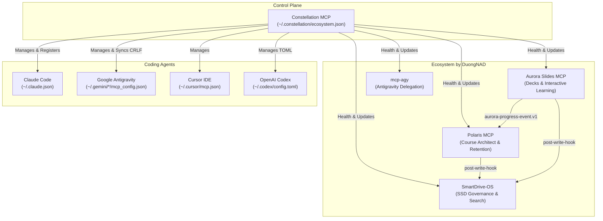

# Constellation MCP: Ecosystem Control Plane Guide

Constellation is the control plane for the learner's MCP ecosystem:
- One manifest of servers (`~/.constellation/ecosystem.json`).
- One command to register them in every coding agent (Claude Code, Google Antigravity, Cursor, Codex).
- Stdio health checks and tool discovery.
- Drift detection engine across all agent configurations.
- Safe git-backed updates with fast-forward only.
- Shared contracts maintaining cross-project compatibility.

---

## 1. Manifest (`ecosystem.json`)

Located at `~/.constellation/ecosystem.json` (or `$CONSTELLATION_HOME/ecosystem.json`).

### Schema Definition
- `version`: String version identifier (e.g. `"1"`).
- `servers`: Array of server configuration objects:
  - `name`: Unique server name (e.g. `"polaris"`).
  - `description`: Purpose of the MCP server.
  - `repo`: Optional Git repository URL.
  - `path`: Optional local filesystem path.
  - `transport`: Currently `"stdio"`.
  - `command`: Executable command (e.g. `"node"`, `"python"`).
  - `args`: Array of command line arguments.
  - `env`: Optional environment variables. Secrets use `${secret:NAME}` references.
  - `agents`: Target agents array (`["claude", "antigravity", "cursor", "codex"]`).
  - `build`: Optional build command.
  - `test`: Optional test command.
  - `health`: Optional `{ "timeoutMs": 20000 }`.

---

## 2. Supported Agents

1. **Claude Code (`claude`)**:
   - Registered via `claude mcp add --scope user` or fallback direct sync in `~/.claude.json`.
2. **Google Antigravity (`antigravity`)**:
   - Reconciles across `~/.gemini/antigravity/mcp_config.json`, `~/.gemini/config/mcp_config.json`, `~/.gemini/antigravity-ide/mcp_config.json`, and `~/.gemini/antigravity-cli/mcp_config.json`.
   - Preserves CRLF line endings and 2-space indentation.
3. **Cursor IDE (`cursor`)**:
   - Manages `~/.cursor/mcp.json`.
4. **OpenAI Codex (`codex`)**:
   - Manages `~/.codex/config.toml` (`[mcp_servers.<name>]` tables).

---

## 3. Tool Reference

- `eco_status {server?}`: Displays unified registration and drift matrix across all agents.
- `eco_import {dry_run?}`: Imports existing agent configurations into the manifest with secret masking.
- `eco_register {servers?, agents?, dry_run?}`: Registers servers in agent configuration files with rolling backups.
- `eco_unregister {server, agents?, dry_run?}`: Removes a server from targeted agent configurations.
- `eco_health {servers?, timeout_ms?}`: Executes stdio client handshakes and tool discovery.
- `eco_doctor`: Detects configuration drift, missing file paths, duplicate servers, and Antigravity copy mismatches.
- `eco_update {servers?, pull?, build?, test?}`: Performs safe `git pull --ff-only` on clean trees, then runs builds and tests.
- `eco_contracts {action, name?, file?}`: Lists shared contracts, displays specs, or validates event lines.

---

## 4. Safety Principles

- **Rolling Backups**: Every write generates `<file>.bak.constellation`.
- **Atomic Writes**: Writes occur to temporary files and rename atomically.
- **Zero Secret Leaks**: Any environment variable matching `/KEY|TOKEN|SECRET|PASSWORD|AUTH/i` is masked as `"***"` and stored as `${secret:NAME}`.
- **Idempotent**: Re-running registration produces zero changes when files match.
- **No Recursive Scans**: Direct path access only; no whole-drive scanning.
